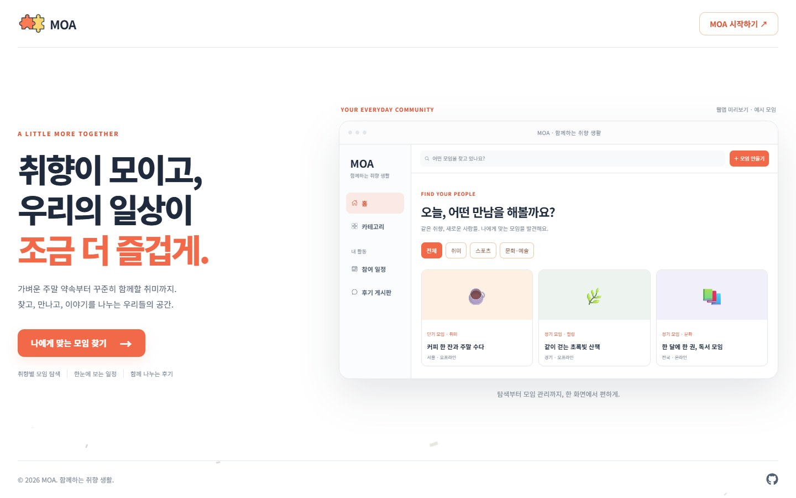
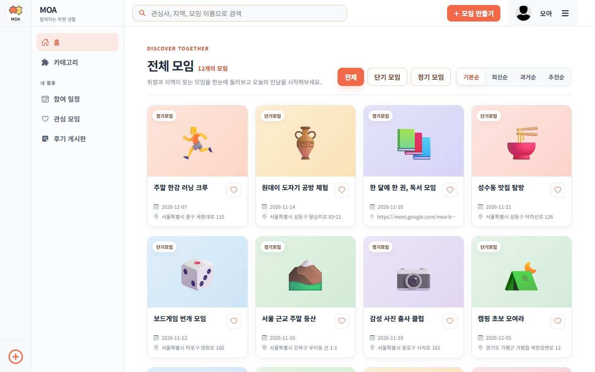
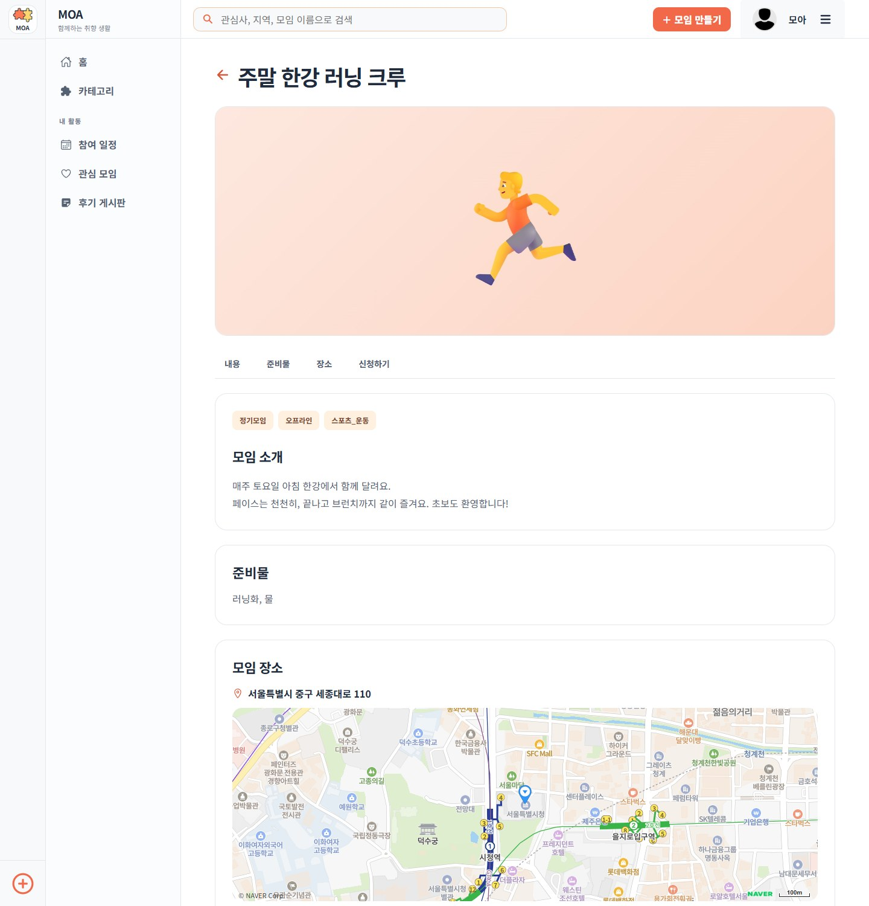
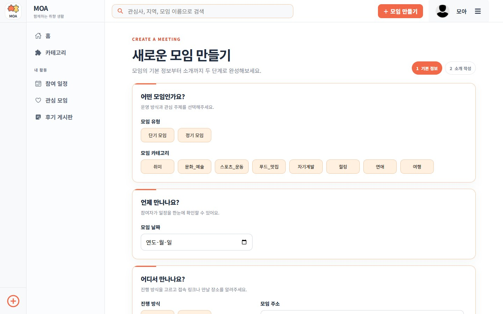
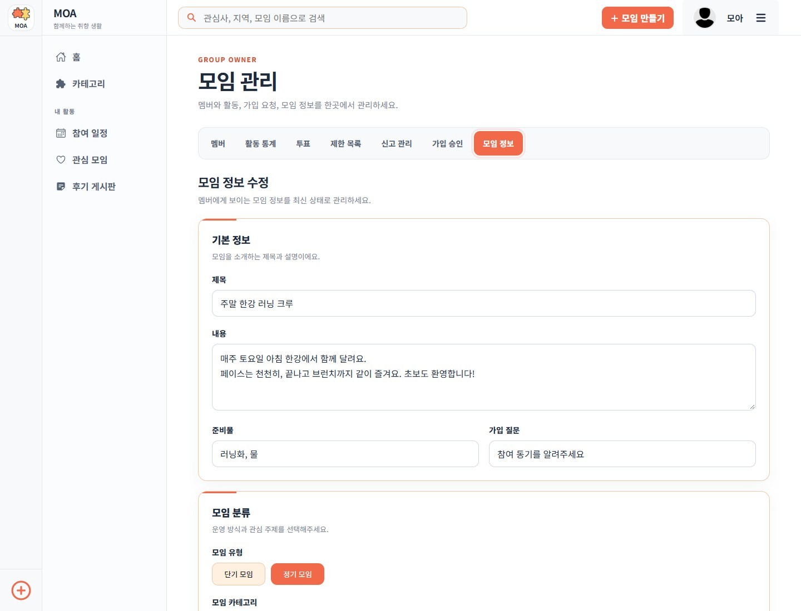
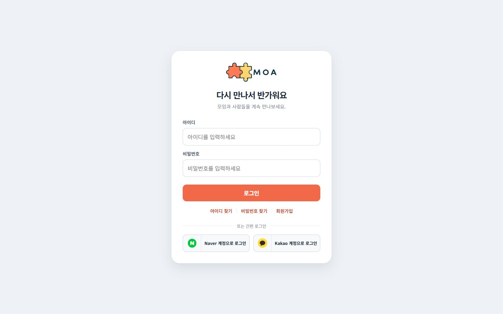
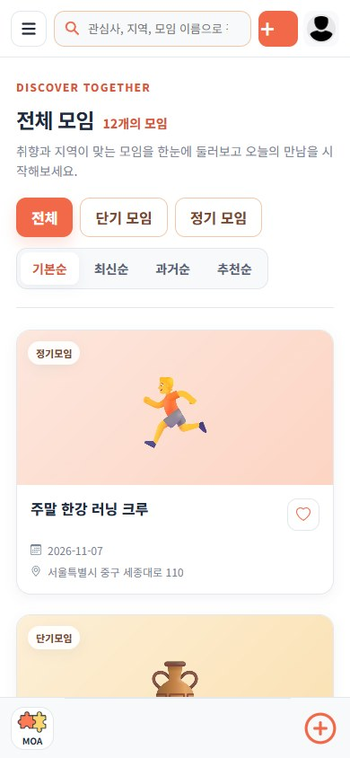
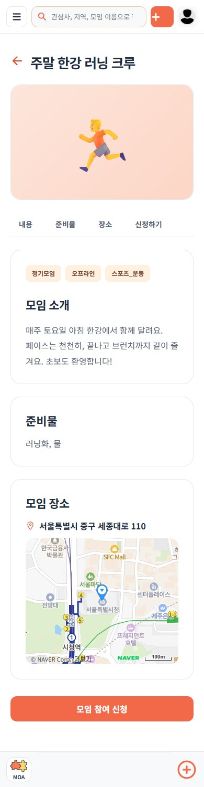
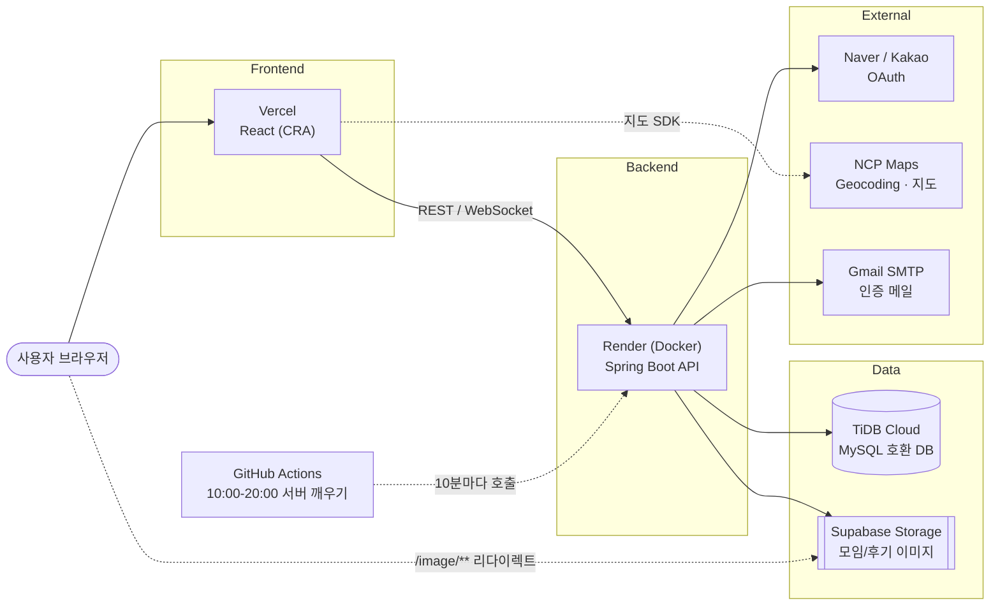

<div align="center">


# MOA

**취향이 모이고, 우리의 일상이 조금 더 즐겁게.**

취향이 맞는 사람들과 모임을 만들고, 찾고, 함께 이야기하는 취미 커뮤니티 플랫폼

<br />

[](https://moa-project-drab.vercel.app)


-4479A1?style=flat-square&logo=mysql&logoColor=white)


</div>

<br />

> **데모 안내** — 백엔드는 무료 호스팅(Render)이라 서버가 잠들어 있으면 **첫 접속에 1~3분**이 걸릴 수 있습니다.
> 서버는 매일 **10:00 ~ 20:00 (KST)** 에 깨어 있도록 설정되어 있습니다. 그 외 시간에는 첫 화면이 뜰 때까지 조금만 기다려 주세요.

<br />

## 미리보기

> 아래 화면은 예시 데이터로 캡처했습니다.

<div align="center">
  
</div>

<br />

<table>
  <tr>
    <td width="50%"></td>
    <td width="50%"></td>
  </tr>
  <tr>
    <td align="center"><b>모임 탐색</b><br />카테고리·유형·정렬로 모임을 한눈에</td>
    <td align="center"><b>모임 상세</b><br />소개, 준비물, 네이버 지도 위치까지</td>
  </tr>
  <tr>
    <td width="50%"></td>
    <td width="50%"></td>
  </tr>
  <tr>
    <td align="center"><b>모임 만들기</b><br />카카오 주소 검색으로 간편하게 장소 입력</td>
    <td align="center"><b>모임 관리</b><br />멤버, 통계, 투표, 신고, 가입 승인을 한곳에서</td>
  </tr>
</table>

<br />

<table>
  <tr>
    <td width="50%" align="center"><br /><b>로그인</b> · 네이버/카카오 간편 로그인</td>
    <td width="25%" align="center"><br /><b>모바일</b></td>
    <td width="25%" align="center"><br /><b>모바일</b></td>
  </tr>
</table>

<br />

## 주요 기능

| 영역 | 내용 |
|---|---|
| **회원** | 일반 회원가입/로그인, **네이버·카카오 소셜 로그인**, 이메일 인증을 통한 아이디·비밀번호 찾기, 프로필·비밀번호 관리 |
| **모임 탐색** | 카테고리·지역·키워드 검색, 단기/정기 모임 필터, 최신순·과거순·추천순 정렬, 관심 모임 저장 |
| **모임 운영** | 모임 생성·수정·삭제, **카카오 주소 검색**, **네이버 지도**로 위치 표시(온라인 모임은 접속 링크), 대표 이미지 업로드 |
| **참여** | 가입 질문과 답변 → 모임장 승인, 멤버 목록, 참여 일정 확인 |
| **소통** | **실시간 채팅(WebSocket/STOMP)**, 후기 게시판(이미지 첨부), 공지사항 |
| **관리** | 멤버 등급 관리, 제한(블랙리스트), **투표**, 신고 처리, **활동 통계 차트**(성별·등급·월별 가입 비율) |
| **UX** | 반응형 레이아웃(모바일 하단 내비게이션), 공통 UI 컴포넌트와 일관된 디자인 시스템, 로딩/빈 상태/오류 상태 처리 |

<br />

## 기술 스택

| 구분 | 사용 기술 |
|---|---|
| **Frontend** | React 18, TypeScript, React Router 6, Emotion, MUI Base, Zustand, Axios, Recharts, react-icons |
| **Backend** | Spring Boot 3.3, Java 17, Spring Security, Spring Data JPA, Spring WebSocket(STOMP), Spring Mail, OAuth2 Client, JWT(jjwt) |
| **Database** | MySQL 호환 — 로컬은 MySQL, 배포는 TiDB Cloud |
| **Storage** | 이미지: 로컬 디스크 또는 Supabase Storage(공개 버킷) 선택 |
| **외부 API** | 네이버 지도(NCP Maps), 카카오 우편번호 검색, 네이버/카카오 OAuth, Gmail SMTP |
| **Deploy** | Vercel(프론트), Render(백엔드, Docker), TiDB Cloud(DB), Supabase(이미지), GitHub Actions(서버 깨우기) |
| **Test** | Jest + Testing Library(프론트), JUnit 5 + MockMvc(백엔드) |

<br />

## 아키텍처



**로그인 흐름(소셜)** — 서버가 OAuth 인증 후 JWT를 URL에 노출하지 않고 **1회용 코드(60초 유효)** 만 프론트로 전달하고, 프론트가 이 코드를 `POST /api/v1/auth/oauth-exchange`로 교환해 토큰을 받습니다.

<br />

## API 개요

모든 API는 `/api/v1` 아래에 있으며, 인증이 필요한 요청은 `Authorization: Bearer <JWT>` 헤더를 사용합니다.

| 경로 | 설명 |
|---|---|
| `/auth` | 회원가입, 로그인, 소셜 로그인 코드 교환, 중복 확인, 공개 모임 목록 |
| `/users` | 내 정보 조회·수정, 비밀번호 변경 |
| `/meeting-group` | 모임 생성·수정·삭제, 상세, 검색 |
| `/recommendation` | 관심 모임 |
| `/user-list` | 멤버 목록, 등급, 탈퇴/제한, 통계 |
| `/user-answers` | 가입 신청과 승인 |
| `/reviews` | 후기 |
| `/votes`, `/vote-results` | 투표와 결과 |
| `/reports`, `/black-list` | 신고, 제한 목록 |
| `/notices` | 공지사항 |
| `/mails` | 인증 메일 발송 |
| `/chat` | 채팅 (WebSocket 엔드포인트 `/ws`) |

<br />

## 프로젝트 구조

```
Moa-Project
├─ moa-web/moa        React 프론트엔드 (CRA, TypeScript)
│  └─ src
│     ├─ views        페이지 (auth, home, group-detail, manager, my-page, ...)
│     ├─ components   공통 UI(ui/), 모임 카드/목록, 지도
│     ├─ layouts      루트·내비게이션·검색 레이아웃
│     └─ styles       테마와 디자인 토큰
├─ moa-was/moa        Spring Boot 백엔드
│  └─ src/main/java   controller · service · repository · entity · dto · config · storage
├─ moa-etc            SQL 스키마
├─ docs               설계 문서와 README 이미지
└─ .github/workflows  서버 깨우기 스케줄
```

<br />

## 로컬 실행

### 백엔드
`moa-was/moa/.env`를 만든 뒤 `moa-was/moa`에서 실행합니다.

```
DB_USERNAME=...
DB_PASSWORD=...
JWT_SECRET=...            # base64 문자열 (32바이트 이상)
MAIL_USERNAME=...         # Gmail 주소
MAIL_PASSWORD=...         # Gmail 앱 비밀번호(16자)
KAKAO_CLIENT_ID=...
KAKAO_CLIENT_SECRET=...
NAVER_CLIENT_ID=...
NAVER_CLIENT_SECRET=...
APP_FRONTEND_URL=http://localhost:3000
```

```bash
./gradlew bootRun        # http://localhost:6060
```

JWT 시크릿은 PowerShell에서 만들 수 있습니다.

```powershell
$b = New-Object byte[] 64; [System.Security.Cryptography.RandomNumberGenerator]::Create().GetBytes($b); [Convert]::ToBase64String($b)
```

### 프론트엔드
`moa-web/moa/.env`를 만든 뒤 실행합니다.

```
REACT_APP_API_URL=http://localhost:6060
REACT_APP_FRONTEND_URL=http://localhost:3000
REACT_APP_NAVER_API=...   # NCP Maps Application의 Client ID
```

```bash
npm install
npm start                # http://localhost:3000
```

### 테스트

```bash
cd moa-was/moa && ./gradlew test
cd moa-web/moa && npm test
```

<br />

## 무료 배포 구성

| 구성 | 서비스 | 비고 |
|---|---|---|
| 프론트 | Vercel | Root Directory `moa-web/moa`, `vercel.json`에 빌드 설정과 SPA 라우팅 |
| 백엔드 | Render 무료 Web Service (Docker) | Root Directory `moa-was/moa`, 15분 미사용 시 잠듦 |
| DB | TiDB Cloud 무료 (MySQL 호환) | 접속 정보를 `DB_URL`로 전달 |
| 이미지 | Supabase Storage | 공개 버킷, `/image/**`는 버킷 주소로 리다이렉트 |

### 백엔드 환경변수 (Render)
로컬 `.env`의 값에 더해 아래를 설정합니다.

| 변수 | 예시 / 설명 |
|---|---|
| `DB_URL` | `jdbc:mysql://<host>:4000/moa_db?sslMode=VERIFY_IDENTITY` |
| `DB_USERNAME`, `DB_PASSWORD` | DB 계정 |
| `APP_FRONTEND_URL` | 배포된 프론트 주소 (예: `https://moa-project-drab.vercel.app`, `https://`까지 포함, 끝에 `/` 없이) |
| `APP_CORS_ALLOWED_ORIGINS` | 위와 동일 (여러 개는 쉼표로 구분) |
| `STORAGE_TYPE` | `supabase` (기본값 `local`: 서버 디스크에 저장) |
| `SUPABASE_URL` | `https://<프로젝트ref>.supabase.co` |
| `SUPABASE_SERVICE_KEY` | Supabase Secret key (서버 전용, 프론트에 넣지 말 것) |
| `SUPABASE_BUCKET` | 공개(public) 버킷 이름, 기본값 `moa-images` |
| `JPA_DDL_AUTO` | 최초 1회 `update`(테이블 생성), 이후 `none` 권장 |
| `JPA_SHOW_SQL` | `false` |
| `PORT` | Render가 자동 주입 |

### 프론트엔드 환경변수 (Vercel)
| 변수 | 값 |
|---|---|
| `REACT_APP_API_URL` | 배포된 백엔드 주소 (예: `https://moa-api-xxxx.onrender.com`) |
| `REACT_APP_NAVER_API` | NCP Maps Client ID |

### 배포 후 외부 서비스 설정
- 카카오: Redirect URI에 `https://<백엔드 주소>/oauth2/callback/kakao` 추가
- 네이버 개발자센터: Callback URL에 `https://<백엔드 주소>/oauth2/callback/naver`, 서비스 URL에 프론트 주소 추가
- NCP Maps Application: Web 서비스 URL에 프론트 도메인(포트 없이) 추가
- 최초 배포 후 취미 기본 데이터(8개)를 한 번 입력해야 회원가입에서 취미를 선택할 수 있습니다.

### 알려진 제한
- 무료 서버는 15분 동안 요청이 없으면 잠들어 첫 응답이 느립니다. 이 저장소의 GitHub Actions(`keep-alive.yml`)가 10:00~20:00(KST)에 주기적으로 호출해 깨워 둡니다.
- 채팅(WebSocket)은 서버가 잠들면 연결이 끊깁니다.
- `STORAGE_TYPE=local`(기본)이면 업로드 이미지가 서버 디스크에 저장되어 무료 서버 재시작 시 사라집니다. 배포에서는 `supabase`를 사용하세요.
